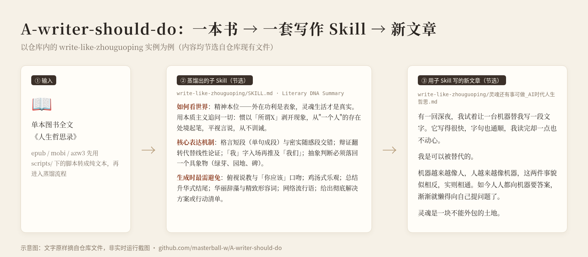

[English](README.md) · [中文](README_zh.md)

# A-writer-should-do

An agent skill that reads one book and compiles a second skill for drafting, rewriting, and checking new prose in that work's verified patterns.

[](https://github.com/masterball-w/A-writer-should-do/stargazers)
[](https://github.com/masterball-w/A-writer-should-do/releases/tag/v2.1.0)


This repository is a set of `SKILL.md` instructions for an agent host (Cursor, Claude Code, or another host that loads a skill folder). It is not a model, a Python library, or a program that restyles text by itself. The Python files only turn EPUB, MOBI, and AZW3 files into plain text.

The current git tag is [`v2.1.0`](https://github.com/masterball-w/A-writer-should-do/releases/tag/v2.1.0), and it points at `main`. The parent skill and the seven included child skills do not use the same filenames. See [Two layouts in this repository](#two-layouts-in-this-repository).

## What it is

The parent skill, [`SKILL.md`](SKILL.md) (`name: a-writer-should-do`), is the distillation procedure. You give the agent the full text of one book. It samples the book by function, keeps only patterns that have evidence, and writes a child folder `write-like-{author-or-work}/` plus a report `{书名}_声纹蒸馏报告.md` in the working directory.

A child skill is what you load when you want new prose. The seven folders already in the repo are finished children. Each one says it was distilled from a single book, and each one says it does not cover that author's other books.

The parent skill's own rules:

- One book stands for that work, that period, and that genre. A stable author-level fingerprint needs the same mechanism in at least three works from different periods.
- A core fingerprint needs at least three pieces of evidence from different chapters and at least one counterexample. A count is a reason to look, not a reason to keep the pattern.
- Do not copy sentences, proper names, characters, plots, original metaphors, or real biographical episodes into new writing.
- Words such as "cold" or "light" are not instructions. They are checked only after architecture, material, and sentence behavior are already in the draft.

## Features

What the parent skill actually specifies:

- **Six-step distillation**, after an extract-and-clean step: decide the work's boundary, build a stratified sample set with metadata, extract four fingerprint layers, check evidence and counterexamples, compile operation cards, then run a regression on three short samples (800–1500 Chinese characters: a low-conflict scene, a high-pressure scene, and a memory / argument / exposition scene).
- **Four layers, kept separate.** Architecture (what state a unit enters and leaves), content (what is selected and how much space it gets), language (measured per function: narration, dialogue, memory, argument), and a final "qi-yun" check that must still be visible after the signature words are deleted.
- **Operation cards** with one format: input, steps, observable output, pass/fail check, rework, evidence id, and where the card does not apply. Low-frequency observations stay in the report and do not become generation rules.
- **Four grades inside a child skill:** A, global constraints loaded before the draft; B, three to five scene cards per scene; C, the language profile for the current function; D, end-of-draft checks, including common AI failures. D-level negative samples are not loaded while the draft is being written.
- **Shared working tables:** a character-interest table, a scene card, a paragraph card, and a dialogue-action table. The dialogue table is for analyzing continuous quoted speech the source book already has. If the book reports speech instead, the table is not a generation step.
- **Where files go.** The report stays in the working directory. The child skill goes to a directory you name; if you do not name one, the agent asks. A finished piece is saved as `{title}.md` in the working directory, and a name clash gets a numeric suffix instead of a silent overwrite.

What each shipped child skill contains (this is the older layout, still the files on disk):

- A dispatcher `SKILL.md` with a Literary DNA Summary, a short style charter, the load order, up to five Common Failure Modes (`错误` / `原因` / `修正`), a checklist, a seed-text library used as structure reference, and a boundary note.
- Six dimension files, loaded in order: spirit, motifs, narrative mechanism, rhythm, technique and negative space, then a final edit.
- In dimensions 1–5, rules are marked ✅ (follow), ❌ (avoid), 💡 (optional technique), and 🤖 (AI-pattern avoidance for that dimension). A rule sometimes cites a count from the book. The child files do not define one numeric cutoff that every ✅ must meet. The three-instance rule is the parent skill's.
- Inside one child, the A1–A13 table lives only in dimension 6 (`06-generation-editor.md`): sentence patterns A1–A13, diction B1–B8, structure C1–C6, texture D1–D5, then a reality check, three edit questions (what to delete, where to pause, where to leave a gap), human-writing moves E1–E8, a narrative-logic pass, and an anti-imitation section. Dimensions 1–5 still have their own 🤖 lines. The list is a checklist for the agent, not a classifier.

Ebook extraction, which both the parent skill and the scripts implement:

| Script | Input | Dependencies | Behavior in code |
|---|---|---|---|
| `scripts/extract_epub.py` | `.epub` | Python standard library | Reads `META-INF/container.xml`, walks the OPF spine, strips non-body markup, writes plain text in spine order |
| `scripts/extract_mobi.py` | `.mobi` | `pip install mobi`, or Calibre's `ebook-convert` | Tries the `mobi` package first, then Calibre. The Calibre path converts to EPUB and reuses the EPUB script |
| `scripts/extract_azw3.py` | `.azw3` | Calibre's `ebook-convert`, or `pip install mobi` | Tries Calibre first, then the MOBI script |
| `scripts/_text_clean.py` | none (not a CLI) | standard library | Shared HTML-to-text cleaner and `h1`–`h6` heading index |

Each extractor writes two UTF-8 files next to each other:

- `{stem}_fulltext.txt` — body text
- `{stem}_toc.txt` — one entry per line: `index<TAB>indented title<TAB>character offset` into the full text

EPUB contents come from the NCX nav map, then an EPUB 3 `nav` document named `nav.xhtml`, `nav.html`, or `toc.xhtml`, then `h1`–`h6` headings if both are missing. The scripts exit with an error when the file is missing, the container has no OPF, or no body text is found. DRM-protected files are not unpacked; the MOBI and AZW3 scripts tell you to remove DRM yourself and then stop. This repository does not include DRM-removal steps.

## Two layouts in this repository

New distillations follow the parent [`SKILL.md`](SKILL.md). It tells the agent to create:

```text
write-like-{author-or-work}/
├── SKILL.md
├── 01-world-and-material.md
├── 02-character-and-information.md
├── 03-architecture-and-scene.md
├── 04-voice-and-syntax.md
├── 05-expression-and-space.md
└── 06-generation-and-validation.md
```

It also asks for a `_meta/` directory of sample records (JSON or CSV) during analysis. No `_meta/` example is checked in.

The seven children below were built earlier. Their files are `01-author-spirit.md`, `02-theme-worldview.md`, `03-narrative-mechanism.md`, `04-language-rhythm.md`, `05-expression-and-space.md`, and `06-generation-editor.md`. Load those files when you use these children. Do not rename them to the parent template; nothing in the repo maps one name to the other.

| Child folder | Book named in that skill | Scope the skill itself states |
|---|---|---|
| `write-like-pha` | 《人生拒绝清单》, pha, translated by 程俐 | Self-deprecating, negative definitions. Language rules include the translator. |
| `write-like-zhouguoping` | 《人生哲思录》 | Aphorism plus informal essay. Not his academic books. |
| `write-like-yuhua` | 《我们生活在巨大的差距里》 | Yu Hua's essays in that collection. Not his novels. |
| `write-like-yuhua-novel` | 《活着》 | The novel. The skill says to use this folder, not `write-like-yuhua`, for fiction. |
| `write-like-liuzhenyun` | 《一日三秋》 | That novel's telling voice. Not his other novels. |
| `write-like-lijieren` | 《死水微澜》 | That novel. Not the later two books of the trilogy. |
| `write-like-moyan` | 《蛙》 | Later Mo Yan: reported speech, a letter frame, suspended judgment. The skill says it does not cover the density of 《红高粱》 or 《生死疲劳》. |

The [v2.1.0 release notes](https://github.com/masterball-w/A-writer-should-do/releases/tag/v2.1.0) and the previous README describe a four-genre rule set (fiction, argumentative nonfiction, essay, practical writing) applied at analysis, extraction, generation, and checking. Those sections are not in `SKILL.md` or in the child files. This README does not treat them as current behavior.

## Install

Requires Git, and Python 3.8+ only when you extract an ebook. Installing a skill means copying a folder onto the agent's skill path. The parent's `name` field is `a-writer-should-do`; on Cursor the folder name should match.

```bash
git clone https://github.com/masterball-w/A-writer-should-do.git

# Cursor, user-wide. A project-local copy lives in .cursor/skills/ instead.
mkdir -p ~/.cursor/skills
cp -r A-writer-should-do ~/.cursor/skills/a-writer-should-do

# Claude Code, user-wide. A project-local copy lives in .claude/skills/ instead.
mkdir -p ~/.claude/skills
cp -r A-writer-should-do ~/.claude/skills/a-writer-should-do
```

To write with an existing child and not distill anything, copy that folder by itself:

```bash
cp -r A-writer-should-do/write-like-zhouguoping ~/.cursor/skills/
```

Optional extractors:

```bash
pip install mobi          # MOBI, and the AZW3 fallback
# Calibre provides ebook-convert, used by AZW3 first and by MOBI as a fallback
```

There is no `requirements.txt` and no installable package.

## Usage

### 1. Make plain text

`.txt` and `.md` can be passed through as they are. For an ebook, create the output directory first. The scripts do not create it.

```bash
mkdir -p "$HOME/books/out"

python3 scripts/extract_epub.py "$HOME/books/book.epub" -o "$HOME/books/out"
python3 scripts/extract_mobi.py "$HOME/books/book.mobi" -o "$HOME/books/out"
python3 scripts/extract_azw3.py "$HOME/books/book.azw3" -o "$HOME/books/out"
```

`-o` defaults to the input file's directory. On success the script prints the two output paths, the character count, and the number of TOC entries.

### 2. Distill with the parent skill

In the agent chat, point at the extracted text and say where the child skill should be saved:

```text
Use a-writer-should-do on ~/books/out/书名_fulltext.txt.
Use ~/books/out/书名_toc.txt as the table of contents.
Save the write-like-* folder to ~/.cursor/skills/.
```

You can also invoke it by name (`/a-writer-should-do` on hosts that work that way). If you leave the destination out, the skill says to ask before writing the folder. The report is written to the working directory.

A finished child from this procedure uses the new filenames in [Two layouts](#two-layouts-in-this-repository), not the filenames of the seven existing children.

### 3. Write with a child skill

```text
Use write-like-zhouguoping to write an essay of about 1500 Chinese characters
on what a person still does in a time of machine-written text.
```

The shipped children tell the agent to read the Literary DNA Summary first, draft with dimensions 1–5 in order, then run the whole of dimension 6. The piece is saved as `{文章标题}.md` in the working directory. The parent skill adds: if that name exists, append a number, do not overwrite.

The same folders also describe narrower jobs: rewrite a passage, or check a draft against the checklist and the failure modes.

## Examples

The picture uses only text already stored in this repo. It is the shipped Zhou Guoping child (the older six-file layout), not a live run of the current parent template.

<p></p>

Source of the picture: [`docs/src/demo.html`](docs/src/demo.html).

**Child skill, Literary DNA Summary** in [`write-like-zhouguoping/SKILL.md`](write-like-zhouguoping/SKILL.md) (abridged):

> Core mechanism: one-sentence aphorisms alternate with denser informal paragraphs; a claim is reversed instead of proved in a straight line; "I" enters before "we"; an abstract judgment has to land on a concrete thing.
>
> Do not: talk down to the reader, end with a moral, offer a complete plan, or use ornate adjectives.

**Piece written with that child:** [`write-like-zhouguoping/灵魂还有事可做_AI时代人生哲思.md`](write-like-zhouguoping/灵魂还有事可做_AI时代人生哲思.md) (abridged). The file header says it was written with `write-like-zhouguoping`.

> 有一回深夜，我试着让一台机器替我写一段文字。它写得很快，字句也通顺，我读完却一点也不动心。我想起从前自己写东西，为一句话想半天，删了又写，写了又删，心里倒是高兴的。
>
> 我是可以被替代的。
>
> 机器越来越像人，人越来越像机器，这两件事貌似相反，实则相通。如今人人都向机器要答案，渐渐就懒得向自己提问题了。

The single-sentence paragraph and the reversal ("貌似相反，实则相通") are the two moves named in that summary. The essay is new prose stored in the repo; it is not the source book.

## Project structure

```text
A-writer-should-do/
├── SKILL.md                 # Parent procedure (current distillation spec)
├── README.md                # This file
├── README_zh.md             # Chinese README
├── LICENSE                  # MIT License, copyright 2026 masterball-w
├── CONTRIBUTING.md
├── CHANGELOG.md
├── .github/ISSUE_TEMPLATE/  # Bug report and feature request
├── docs/
│   ├── images/demo.png
│   └── src/demo.html
├── scripts/
│   ├── extract_epub.py
│   ├── extract_mobi.py
│   ├── extract_azw3.py
│   └── _text_clean.py
├── write-like-pha/          # 1 dispatcher + 6 dimension files
├── write-like-zhouguoping/  # same, plus one sample essay
├── write-like-yuhua/
├── write-like-yuhua-novel/
├── write-like-liuzhenyun/
├── write-like-lijieren/
└── write-like-moyan/
```

Each child folder is the dispatcher plus `01` through `06`. There is no test suite and no `requirements.txt`. The license is MIT; see below.

## Limitations

These are gaps in the current tree, not planned behavior:

- Parent template and the seven children use different filenames, different section schemes, and different rule formats.
- Step 3 of the parent skill tells the agent to measure sentence-length percentiles, short-sentence share (≤15 characters), long-sentence share (≥50), words, and punctuation **with a script**, on samples of the same function, and not to invent the numbers. `scripts/` only contains the ebook extractors.
- `extract_mobi.py`, on the `mobi` package path, does not map NCX links to character offsets. It pairs TOC entry *i* with the start of HTML file *i*. The EPUB 3 nav parser records every entry at depth 0.
- Passing `-o` to a directory that does not exist makes the script fail when it opens the output file.
- Child seed libraries quote passages from the source books and tell the agent to copy their structure, not their sentences. The parent skill forbids transferring original sentences into a child skill. Both statements are in the repo.
- Nothing here is an automated detector of AI-written text. Dimension 6 is a list the agent checks by hand.

## Contributing

Bug reports and feature requests use the templates in [`.github/ISSUE_TEMPLATE/`](.github/ISSUE_TEMPLATE/). Pull requests that fix an extractor, correct a rule against the book it cites, or bring the parent template and the children into one layout are welcome. Read [`CONTRIBUTING.md`](CONTRIBUTING.md) before sending a large skill folder: do not commit a full copyrighted book, and do not add DRM-removal instructions.

## License

This project is released under the [MIT License](LICENSE). Copyright (c) 2026 masterball-w.

The MIT grant covers the skill files, scripts, and documentation in this repository. Passages quoted from books inside the child skills remain under those books' own copyright. MIT does not relicense those quotations.

## Maintainer's other project

- [supplement-checker](https://github.com/masterball-w/supplement-checker) — a separate agent skill: photograph a supplement, then check ingredient research, regional registration, and prices. It is not part of this repository.
